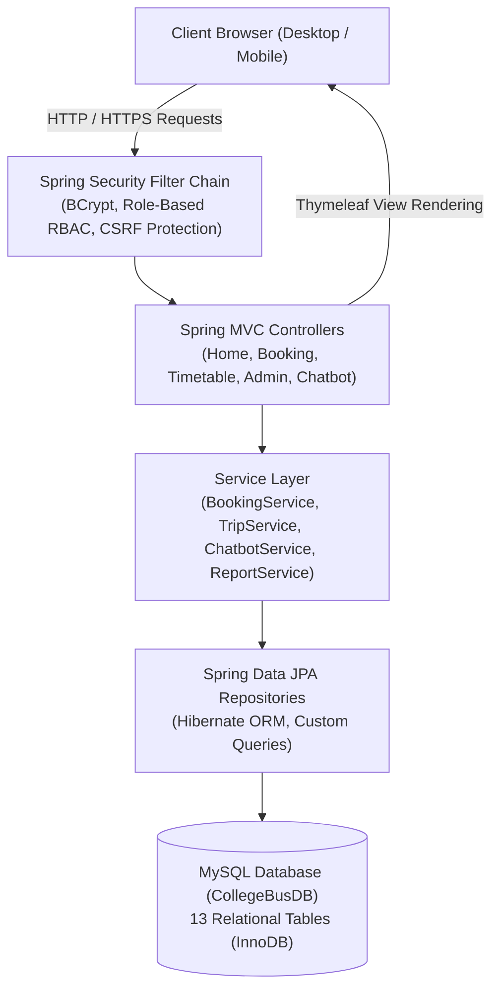

# Smart College Bus Allocation System

[](https://www.oracle.com/java/)
[](https://spring.io/projects/spring-boot)
[](https://www.mysql.com/)
[](https://www.thymeleaf.org/)
[](https://getbootstrap.com/)
[](LICENSE)

An integrated full-stack campus transit management web application developed using **Java 17**, **Spring Boot**, **Spring MVC**, **Spring Data JPA**, **Spring Security**, and **MySQL**. The system unifies bus route scheduling, real-time confirmed seat allocation, academic timetable sync, examination-based return bus recommendations, administrator fleet management, passenger-demand analytics, and a database-connected virtual transportation assistant named **Talk to Aadhi**.

---

### 🎓 Academic Review & Prescribed Requirements Compliance
> **Mandatory Review Criteria Satisfied:** Equal importance is given to both **Core Object-Oriented Programming (OOP)** and **Relational Database Management Systems (DBMS)**.
> - **Language & Runtime:** Implemented using **Java 17 / 21** and Spring Boot 3.2.5.
> - **All 6 Core OOP Concepts:** Encapsulation, Multi-level Inheritance, Polymorphism (Overloading & Overriding), Abstraction (Abstract Classes & Interfaces), Packages, and Custom Exception Handling with Try-Catch-Finally.
> - **Proper DBMS Architecture:** 13 normalized tables (`CollegeBusDB`) with primary keys, foreign keys, constraints, and indexes.
> - **Direct JDBC CRUD & ACID:** Pure `java.sql` JDBC DAOs executing **CREATE, READ, UPDATE, and DELETE** operations with transaction rollback.
> - **Interactive Viva Demonstrations:**
>   - **Terminal / Eclipse Runner:** `com.collegebus.oop.runner.OOPAndDBMSDemonstrationRunner`
>   - **Web Architecture Portal:** Live interactive portal at `http://localhost:8080/oop-demo`

---

## Table of Contents

1. [Project Overview](#project-overview)
2. [Problem Statement](#problem-statement)
3. [Proposed Solution](#proposed-solution)
4. [Key Objectives](#key-objectives)
5. [Core Features](#core-features)
6. [Technology Stack](#technology-stack)
7. [System Architecture](#system-architecture)
8. [Database Design & Schema](#database-design--schema)
9. [Pre-Seeded Test Accounts](#pre-seeded-test-accounts)
10. [Prerequisites & Installation](#prerequisites--installation)
11. [MySQL Workbench Setup](#mysql-workbench-setup)
12. [Eclipse IDE Import & Execution](#eclipse-ide-import--execution)
13. [CLI & Maven Execution](#cli--maven-execution)
14. [Talk to Aadhi Virtual Assistant](#talk-to-aadhi-virtual-assistant)
15. [Testing Strategy](#testing-strategy)
16. [Future Enhancements](#future-enhancements)
17. [License & Acknowledgments](#license--acknowledgments)

---

## Project Overview

Higher education engineering and arts institutions transport thousands of day scholars, faculty, and hostel students across metropolitan areas every day. Traditional paper-based bus passes, rigid pickup assignments, and static routes lead to severe bus overcrowding, empty buses on secondary routes, lack of return transit during examinations, and administrative blind spots.

The **Smart College Bus Allocation System** provides ONE centralized, integrated web application where:
- Students and teachers can pick their travel date from a monthly calendar and choose preferred departure time slots.
- Passengers enjoy **flexible pickup and drop-off stop selection** for every single journey without being locked to fixed home stops.
- Bus seat availability is calculated dynamically from actual confirmed database records, completely eliminating overbooking.
- If a bus is full, passengers can place a prioritized **Seat Request** or view connecting trips.
- Examination timetables automatically trigger **intelligent return bus recommendations** based on exam end times.
- Administrators access live passenger-demand reports, manage fleet vehicles, sequence route stops, and assign certified drivers.
- A rule-driven assistant, **Talk to Aadhi**, queries the live MySQL database to answer questions about routes, stops, seat counts, and alternative trips.

---

## Problem Statement

College transportation operations encounter persistent inefficiencies:
1. **Seat Imbalance & Overcrowding:** Key corridors (e.g., Chennai GST Road, Pallavaram, Tambaram) experience severe overcrowding, while other routes run under-utilized.
2. **Inflexible Stop Policies:** Students cannot select different boarding stops when commuting from libraries, project centers, or relative homes.
3. **Exam Schedule Mismatch:** Exams often finish at midday (11:30 AM, 2:30 PM, 4:30 PM), yet standard bus schedules only depart at 05:00 PM, stranding students on campus for hours.
4. **Lack of Live Visibility:** Administrators lack quantitative data showing route congestion and passenger load percentages.
5. **Double Booking & Insecure Data:** Manual records risk duplicate seat allocation and lack role-based access control.

---

## Proposed Solution

A modern, responsive, integrated Spring Boot web application backed by an ACID-compliant MySQL database. The system implements:
- **Mandatory 3-Step Booking:** Travel Date selection &rarr; Time Slot selection &rarr; Matching Bus Search with live remaining seat counts.
- **Seat Request Overflow Mechanism:** Queueing system allowing transport controllers to re-allocate extra capacity without exceeding bus limits.
- **Exam Return Recommendation Engine:** Pairs examination end times with departure trips (e.g. 11:30 AM exam finish &rarr; 12:00 PM bus recommendation).
- **Comprehensive Admin Suite:** Vehicle fleet, driver licensing, route sequencing, booking audits, and demand analytics.
- **Talk to Aadhi:** Embedded assistant querying actual SQL tables for real-time locality information (e.g. Pallavaram, Tambaram, Guindy).

---

## Key Objectives

- Develop a single integrated application without disconnected frontend/backend repositories.
- Implement strict role-based access control (`STUDENT`, `TEACHER`, `ADMIN`) using Spring Security and BCrypt hashing.
- Prevent duplicate active bookings for the same user on the same travel slot.
- Guarantee that seat availability reflects actual confirmed database bookings (`total_seats - confirmed_count`).
- Deliver a clean, accessible UI adhering to the Navy Blue, Light Blue, and White theme.
- Enforce transactional integrity (`@Transactional`, Serializable isolation) to prevent race conditions during concurrent bookings.

---

## Core Features

| Module | Features & Capabilities |
| :--- | :--- |
| **Authentication & Roles** | BCrypt password hashing, Spring Security session control, student/faculty self-registration, protected admin endpoints. |
| **Date & Time Selection** | Monthly calendar view, standard departure slots (6 AM, 7 AM, 8 AM, 9 AM, 12 PM, 3 PM, 5 PM), rejection of past dates. |
| **Bus Search & Routing** | Flexible pickup/dropoff selection, sequence-aware route filtering, live available seats indicator, driver contact display. |
| **Booking Engine** | Real-time reservation, 1-click cancellation with immediate seat release, transaction-safe booking modification, printable boarding passes. |
| **Seat Request Overflow** | Waitlist placement when a bus is full, administrative review, capacity recheck before approval to prevent overbooking. |
| **Exam Recommender** | Timetable integration matching university exam end times with return departure buses; 1-click booking shortcut. |
| **Admin Operations** | Fleet vehicle CRUD, route stop ordering and transit minute estimates, driver management, trip scheduling, booking audit logs. |
| **Demand Analytics** | Occupancy rate calculations, congestion alerts, and actionable fleet reallocation recommendations (e.g. allocate 55-seater for Pallavaram). |
| **Talk to Aadhi Assistant** | Floating interactive chatbot querying live MySQL data for localities (Pallavaram, Tambaram, Guindy, etc.), routes, and seats. |

---

## Technology Stack

### Backend
- **Language:** Java 17 / Java 21
- **Framework:** Spring Boot 3.2.5
- **Modules:** Spring MVC, Spring Data JPA, Spring Security 6, Jakarta Bean Validation
- **Build Tool:** Apache Maven 3.8+

### Database
- **Engine:** MySQL 8.0+ / MySQL 5.7+ (InnoDB)
- **Driver:** MySQL Connector/J (`com.mysql:mysql-connector-j`)
- **Schema Management:** `spring.jpa.hibernate.ddl-auto=validate` (Referential integrity defined in SQL)
- **Testing:** H2 In-Memory DB (used for decoupled automated test suites)

### Frontend
- **Template Engine:** Thymeleaf with Spring Security Extras
- **UI Framework:** Bootstrap 5.3
- **Icons:** FontAwesome 6
- **Scripts:** Modular JavaScript (ES6+, Fetch API, CSRF-aware AJAX)
- **Styling:** Custom CSS3 with Navy Blue (`#0f2a4a`) and Ice Blue (`#e0f2fe`) academic palette

---

## System Architecture



---

## Database Design & Schema

The database `CollegeBusDB` consists of **13 normalized relational tables** using the **InnoDB** storage engine with foreign keys, unique constraints, and composite indexes:

1. `users` &mdash; System accounts with email uniqueness, BCrypt hashed passwords, and roles (`STUDENT`, `TEACHER`, `ADMIN`).
2. `students` &mdash; 1-to-1 extension of `users` with roll number, department, year, semester, student type, and hostel name.
3. `teachers` &mdash; 1-to-1 extension of `users` with employee ID, department, and designation.
4. `buses` &mdash; Physical vehicle fleet tracking bus numbers, registration numbers, capacity, type (AC/Non-AC), and maintenance status.
5. `drivers` &mdash; Driver profiles, phone contacts, license numbers, and on-duty availability.
6. `routes` &mdash; Transportation corridors between origins and college campus.
7. `bus_stops` &mdash; Master catalog of approved Chennai stops with localities (e.g. Pallavaram, Tambaram, Guindy).
8. `route_stops` &mdash; Junction table mapping stops to routes with ordered sequences and estimated travel minutes.
9. `trips` &mdash; Scheduled journeys combining bus, route, driver, travel date, departure time, and booking cutoff time.
10. `bookings` &mdash; Confirmed, cancelled, and modified seat reservations linked to passengers and trips.
11. `seat_requests` &mdash; Overflow passenger requests submitted when buses are full, tracked through `PENDING`, `APPROVED`, or `REJECTED`.
12. `academic_timetable` &mdash; Weekly department subject and laboratory schedules.
13. `exam_timetable` &mdash; Examination schedules used by the return bus recommendation engine.

> **Visual Diagrams:** An interactive SVG/HTML diagram is available in [`database/ER_Diagram.html`](database/ER_Diagram.html) and high-resolution PNG in [`database/ER_Diagram.png`](database/ER_Diagram.png).

---

## Development Demo Accounts (local only)

When the application runs with the default `dev` profile, `DataInitializer` creates local demonstration accounts such as `admin@collegebus.edu` (`Admin@123`), `student@collegebus.edu` (`Student@123`), and `teacher@collegebus.edu` (`Teacher@123`). These are disposable development credentials only. The initializer is disabled outside the `dev` profile.

`database/CollegeBusDB.sql` is a destructive academic/demo script containing sample users and operational records. Never run it against production or any database containing real data. Production provisioning must use [`database/CollegeBusDB-production-schema.sql`](database/CollegeBusDB-production-schema.sql), which creates the schema without demo accounts or sample records. Follow [`docs/DEPLOYMENT.md`](docs/DEPLOYMENT.md) for controlled administrator provisioning.

---

## Prerequisites & Installation

### Requirements
- **Java Development Kit (JDK):** Version 17 or Version 21 installed.
- **MySQL Server:** Version 8.0 or 5.7+ running on `localhost:3306`.
- **MySQL Workbench** or MySQL CLI client.
- **Eclipse IDE for Enterprise Java and Web Developers** (or any standard Java IDE).
- **Git** installed on your system.

---

## MySQL Workbench Setup

1. Open **MySQL Workbench** and connect to your local MySQL instance (`localhost:3306`).
2. Open the SQL file located in the project repository:
   ```
   database/CollegeBusDB.sql
   ```
3. Execute the script (`Execute SQL Script` or press `Ctrl + Shift + Enter`).
4. The script will automatically:
   - Create database `CollegeBusDB`.
   - Create all 13 InnoDB tables with primary keys, foreign keys, and indexes.
   - Insert realistic sample records for Chennai routes (Pallavaram, Tambaram, Guindy, Velachery, Central).
   - Seed sample buses, drivers, timetable entries, and users.
5. In MySQL Workbench Navigator, refresh the schema list and verify `CollegeBusDB` with all 13 tables.

---

## Eclipse IDE Import & Execution

1. Open **Eclipse IDE for Enterprise Java and Web Developers**.
2. Click **File &rarr; Import...**
3. Select **Maven &rarr; Existing Maven Projects** and click **Next**.
4. Set the **Root Directory** to this project's folder (`smtclgbus`).
5. Ensure `pom.xml` is selected and click **Finish**.
6. Eclipse will import the project and resolve dependencies automatically via `m2e`.
7. Configure your MySQL password:
   - In Eclipse, open `src/main/resources/application.properties`.
   - Set `spring.datasource.password=YOUR_PASSWORD` or pass environment variable `DB_PASSWORD`.
8. Right-click on `SmartCollegeBusApplication.java` (under `src/main/java/com/collegebus`).
9. Select **Run As &rarr; Spring Boot App** (or **Run As &rarr; Java Application**).
10. Open your browser and navigate to:
    ```
    http://localhost:8080
    ```

---

## CLI, Maven & Standalone OOP Demonstration

You can run both the full web application and the standalone OOP & DBMS terminal test:

```bash
# 1. Clone repository
git clone https://github.com/Aktchayavarshini/smart-college-bus.git
cd smart-college-bus

# 2. Run the all unit tests (19 test cases covering OOP & DBMS CRUD)
./mvnw clean test

# 3. Run Standalone OOP & DBMS Demonstration Runner (for Viva-Voce / Project Review)
./mvnw test-compile
java -cp "target/classes;target/dependency/*" com.collegebus.oop.runner.OOPAndDBMSDemonstrationRunner

# 4. Run the full Spring Boot Web Application
./mvnw spring-boot:run
```

---

## Talk to Aadhi Virtual Assistant

**Talk to Aadhi** is an intelligent assistant accessible via the floating bubble on any page or at `/talk-to-aadhi`.
- **Direct Database Queries:** Queries actual routes, stops, scheduled departure times, and live remaining seat counts.
- **Corridor Awareness:** Ask *"Find bus to Pallavaram"* or *"Check seats for Tambaram"*.
- **Overflow Suggestions:** If a bus is full, Aadhi detects alternative departure times on that corridor and suggests connecting trips.
- **Exam Bus Assistance:** Asks for your exam finish time and surfaces matching return trips.

---

## Testing Strategy

The project includes unit, integration, and security test suites located in `src/test/java/`:
- **`BookingServiceTest`:** Tests successful booking, bus capacity threshold enforcement, duplicate booking prevention, and transactional cancellation.
- **`ChatbotServiceTest`:** Validates NLP query parsing for localities like Pallavaram, route queries, and booking guidance.
- **`SmartCollegeBusApplicationTests`:** Confirms Spring Boot application context and JPA entity mapping validity against H2 in-memory DB.

Run automated tests:
```bash
mvn test
```

---

## Future Enhancements

- **Push Notifications & SMS Gateways:** Automated SMS alerts upon booking confirmation and seat request approvals.
- **Digital QR Code Boarding Passes:** Fast driver validation using mobile QR code scanners at bus entry doors.
- **Multi-Campus Transit:** Support for cross-campus transfer shuttles and satellite research park routes.

---

## License & Acknowledgments

This project is developed for college academic submission and is open-sourced under the [MIT License](LICENSE).

Developed with pride using modern Java and Spring Boot technologies.


---

## Modern frontend integration (incremental)

A Next.js + TypeScript frontend is being introduced under `frontend/`. The existing Spring Boot + Thymeleaf application remains available and retains the academic OOP/JDBC demonstrations.

- Frontend setup: `cd frontend && npm install && npm run dev`
- Frontend environment: copy `frontend/.env.example` to `frontend/.env.local` and set `NEXT_PUBLIC_API_BASE_URL`.
- Backend API contract: [docs/API_CONTRACT.md](docs/API_CONTRACT.md)
- Production deployment: [docs/DEPLOYMENT.md](docs/DEPLOYMENT.md)

The initial frontend supports public stop discovery and scheduled-trip search. Booking mutations, account management, and administration remain on the existing authenticated application until their API/session contracts are implemented and tested. Do not treat the Next.js UI as a replacement for those flows yet.
